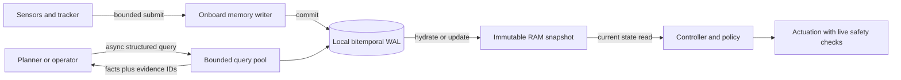

# Onboard memory architecture for an embodied agent

## Deployment goal

Run memory on the robot's onboard computer. Keep motor control independent of
disk latency, network availability, semantic model latency, and database
recovery. The current repository has no perception stack, object tracker, or
ROS 2 package, so this work builds a usable, ROS-agnostic runtime boundary;
it does not pretend to solve perception or provide hard real-time guarantees
from Python.

## Runtime paths

### 1. Control path: bounded RAM read

The action/controller loop reads one immutable latest snapshot by
(robot_id, entity_id, predicate). It performs no SQL, filesystem operation,
network call, model call, or wait. Snapshot replacement happens after a
background commit. Missing, unknown, expired, or stale state is explicit and
must route to the controller's conservative fallback.

The snapshot is capped by max_hot_keys; eviction returns missing, never a
fabricated old value. A snapshot carries a generation and event cursor. Its
read is O(1) in this Python process, but Python scheduling and garbage
collection are not hard real-time. A hard real-time C++ controller should read
a fixed-size shared-memory page or a latest-value ROS 2 message (KEEP_LAST,
depth 1), with a freshness limit.

### 2. Onboard memory service: bounded background work

OnboardMemory is scoped to one robot identity. Sensor/perception/planning
workers submit observations and assertions to a bounded queue. One writer
serializes durable writes; saturation rejects immediately with
MemoryQueueFull and increments a metric. Configured reserve slots are
available to facts, retractions, and explicitly critical observations;
best-effort observations cannot consume that reserve. Callers must handle
rejection and raise an operator fault for safety-critical evidence. They must
never wait for the queue in a control callback.

Historical state, text, and spatial queries run on a separate bounded worker
pool. Saturation returns MemoryQueryBusy. Callers consume receipts and query
futures only from non-control threads. The service publishes a new immutable
hot snapshot only after facts/retractions commit. At startup it hydrates the
bounded snapshot from the local ledger before the controller declares memory
ready.

### 3. Durable local record and evidence

The bitemporal append-only SQLite WAL ledger stores observations, verified
facts, hypotheses, unknown states, and retractions. observed_at is world
time; event IDs and recorded_at are knowledge time. Queries take both clocks,
so delayed upload and correction preserve earlier knowledge views.

High-rate sensor streams, images, and video live in a recorder such as
rosbag2/MCAP or a bounded local media store. The ledger stores evidence
identifiers and timestamps, not camera frames or 500 Hz joint samples. Every
position carries a coordinate-frame ID; transform it at the source timestamp
before writing. The upstream tracker owns persistent entity IDs and
uncertainty.

The current timestamp contract is one timezone-aware robot clock converted to
UTC. Do not mix wall-clock, simulation, or device-monotonic values. A ROS 2
integration needs an explicit clock-domain and boot identifier in the stored
event schema before it combines data across clock resets or replay domains.

## State and safety rules

1. Only upstream physical verification may label a fact verified; detector
   output alone stays a hypothesis.
2. A newer hypothesis, explicit unknown, expired value, or stale value never
   silently falls back to an older verified state.
3. Memory is advisory context. The closed-loop controller still checks current
   sensors and safety interlocks before acting.
4. The controller must have a tested memoryless fallback. A restart begins
   with an empty snapshot until local-ledger hydration succeeds.
5. Time travel is an off-path query. The control snapshot answers current
   state only; historical/counterfactual reads use the durable query API.

## Failure behavior

- Queue full: reject explicitly and count; do not block the caller.
- Disk full or database error: fail the receipt, increment failure metrics,
  keep the last committed snapshot, and surface memory health as degraded.
- Worker/process restart: reopen WAL, hydrate the hot set, then declare
  ready. Caller-supplied idempotency keys make retries safe.
- Power loss: WAL transactions preserve committed records; deployment
  still needs disk health monitoring, rotation/backup, and recovery drills.
- Network loss: local control and memory continue; cloud sync is an
  optional later replication path.

## Build sequence and gates

1. **Implemented:** define the memory/control boundary and single-robot API.
2. **Implemented:** immutable hot snapshots, bounded ingestion with reserved
   capacity, asynchronous bitemporal queries, startup hydration, and counters.
3. **Implemented:** retain the append-only bitemporal ledger as source of truth.
4. **Next:** integrate a real ROS 2 recorder, timestamped TF transforms, stable
   object tracker, and hardware identity; this repository currently has none.
5. **Hardware gate:** measure snapshot read p50/p99/max; write acceptance and
   commit delay; queue high-water/rejection counts; reboot and full-disk
   recovery; stale-state errors; retrieval precision; task success.
6. **Evaluation gate:** compare memory enabled, disabled, and conflicting/donor
   memory using the same task seed and current observation.

No throughput or task-success claim is made until those robot-side measurements
exist.
